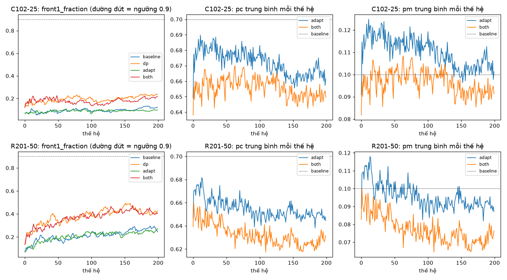

# TV4: kết quả giai đoạn 2 (n = 25, 50) trên baseline thật

Thí nghiệm `tv4_main`; bảng dựng bởi `python -m scripts.tv4_report --exp tv4_main --instances C102-25 R201-50`,
phần chẩn đoán bởi `python -m scripts.tv4_diagnose --exp tv4_main --instances C102-25 R201-50`.

- **Instance:** C102-25 và R201-50. RC201-100 chưa chạy, chờ TV1 quyết định về việc `split_capacity_time` vượt đội xe ở n = 100.
- **Cấu hình:** `baseline` (mọi cờ tắt), `dp` (`improvements.dp_split=true`), `adapt` (`improvements.adaptive_rates=true`), `both` (cả hai), và `baseline_eqtime` (baseline với nhiều thế hệ hơn, xem mục "Equal-time comparison").
- **Thiết lập:** `config.yaml` mặc định (n_pop 80, n_gen 200 trừ `baseline_eqtime`, pc 0.7, pm 0.1, `satisfaction_time: arrival`, `split_rule: capacity_time`, tham số cải tiến mặc định chưa tuning), seed 0–9 cho mọi cấu hình.

## Bảng kết quả

| Instance | Cấu hình | n_gen | HV | ΔHV vs baseline | p (HV) | p (HV) vs eqtime | IGD | p (IGD) | p (IGD) vs eqtime | SP | n_evals | Thời gian/run (s) | Khả thi (front) | Khả thi (quần thể) | Số xe TB (front) | Số điểm front |
|---|---|---|---|---|---|---|---|---|---|---|---|---|---|---|---|---|
| C102-25 | baseline | 200 | 0.9034 ± 0.1763 | — | — | — | 0.2455 ± 0.1070 | — | — | 0.0447 ± 0.0429 | 16080 | 3.8 | 1.00 | 1.00 | 3.0 | 9.7 |
| C102-25 | baseline_eqtime | 1400 | 1.1609 ± 0.0781 | +0.2575 | 0.002 | — | 0.1114 ± 0.0333 | 0.002 | — | 0.0135 ± 0.0093 | 112080 | 56.4 | 1.00 | 1.00 | 3.0 | 34.4 |
| C102-25 | dp | 200 | 0.9998 ± 0.1528 | +0.0963 | 0.174 | 0.016 | 0.1980 ± 0.1001 | 0.364 | 0.082 | 0.0897 ± 0.0732 | 16080 | 25.1 | 1.00 | 1.00 | 3.2 | 19.0 |
| C102-25 | adapt | 200 | 0.8641 ± 0.2028 | -0.0393 | 0.496 | 0.002 | 0.2651 ± 0.1331 | 0.545 | 0.010 | 0.0422 ± 0.0284 | 16080 | 3.9 | 1.00 | 1.00 | 3.1 | 7.9 |
| C102-25 | both | 200 | 1.0505 ± 0.1784 | +0.1471 | 0.059 | 0.112 | 0.1692 ± 0.1179 | 0.082 | 0.450 | 0.0657 ± 0.0544 | 16080 | 25.4 | 1.00 | 1.00 | 3.1 | 18.0 |
| R201-50 | baseline | 200 | 0.6769 ± 0.0573 | — | — | — | 0.2898 ± 0.0395 | — | — | 0.0166 ± 0.0095 | 16080 | 5.8 | 1.00 | 1.00 | 6.9 | 19.7 |
| R201-50 | baseline_eqtime | 3500 | 1.1490 ± 0.0575 | +0.4721 | <0.001 | — | 0.0387 ± 0.0218 | <0.001 | — | 0.0056 ± 0.0040 | 280080 | 201.7 | 1.00 | 1.00 | 4.5 | 80.0 |
| R201-50 | dp | 200 | 0.6825 ± 0.0689 | +0.0056 | 0.406 | <0.001 | 0.3118 ± 0.0573 | 0.450 | <0.001 | 0.0254 ± 0.0106 | 16080 | 91.2 | 1.00 | 1.00 | 6.6 | 34.0 |
| R201-50 | adapt | 200 | 0.5856 ± 0.0394 | -0.0914 | 0.001 | <0.001 | 0.3612 ± 0.0411 | 0.002 | <0.001 | 0.0185 ± 0.0127 | 16080 | 6.0 | 1.00 | 1.00 | 7.7 | 21.6 |
| R201-50 | both | 200 | 0.6656 ± 0.0954 | -0.0113 | 0.705 | <0.001 | 0.3286 ± 0.0785 | 0.226 | <0.001 | 0.0365 ± 0.0219 | 16080 | 92.4 | 1.00 | 1.00 | 6.5 | 32.4 |

Mỗi ô: trung bình ± độ lệch chuẩn qua [10] run (cùng bộ seed cho mọi cấu hình). p-value: Wilcoxon rank-sum hai phía so với baseline cùng instance; chưa hiệu chỉnh đa so sánh.

Lưu ý khi so với bản trước của tài liệu này: bảng nay có thêm `baseline_eqtime` trong reference set, nên **mọi con số HV và IGD đã đổi** (ví dụ HV baseline R201-50 từ 0.884 xuống 0.677) dù các lượt chạy 200 thế hệ không đổi; p-value của HV không đổi vì chỉ phụ thuộc thứ hạng. Chỉ so HV/IGD trong cùng bảng.

## Nhận xét

Ở ngân sách 200 thế hệ, chỉ `adapt` trên R201-50 đạt p < 0.05 trong 12 phép so với baseline (6 HV, 6 IGD) và là theo hướng kém hơn (HV 0.586 so với 0.677, p = 0.001; IGD p = 0.002); các phép so còn lại không phân biệt được với baseline, trong đó `both` trên C102-25 là gần nhất (ΔHV +0.147, p = 0.059), và chưa hiệu chỉnh đa so sánh. `dp` và `both` cho front nhiều điểm hơn (19.0 và 18.0 so với 9.7 điểm trên C102-25; 34.0 và 32.4 so với 19.7 trên R201-50) nhưng SP cao hơn, tức phân bố điểm kém đều hơn. Số xe trung bình trên front gần như không đổi, và mọi cấu hình đều có 100% nghiệm khả thi ở hai kích thước này. Khi cho baseline thêm thế hệ (mục "Equal-time comparison") nó vượt `dp` rõ rệt với chi phí CPU tương đương hoặc thấp hơn, nên ở hai instance này và tham số mặc định chưa có bằng chứng `dp_split` đáng giá hơn việc chạy baseline lâu hơn. Đây là một lượt chạy với tham số chưa tuning trên hai instance, chưa đủ để kết luận cho kích thước lớn hơn hay cho tham số đã tuning.

## Diagnosis: adaptive rates

Dữ liệu: `rate_log` của `adapt` và `both`, hình `docs/tv4_adaptive_rates.png` (front1_fraction, pc, pm trung bình theo thế hệ, trung bình 10 seed; đường chấm là pc/pm cố định của baseline, đường đứt là ngưỡng một-front 0.9).

| Instance | Cấu hình | front1_fraction TB | Thế hệ ở nhánh một-front | pc hiệu dụng | pm hiệu dụng | pc / pm ở thế hệ theo hạng | pc / pm ở thế hệ một-front |
|---|---|---|---|---|---|---|---|
| C102-25 | baseline | 0.094 | 0.0% (chỉ để tham khảo, không dùng) | 0.700 (cố định) | 0.100 (cố định) | — | — |
| C102-25 | dp | 0.194 | 0.0% (chỉ để tham khảo, không dùng) | 0.700 (cố định) | 0.100 (cố định) | — | — |
| C102-25 | adapt | 0.089 | 0.0% | 0.672 | 0.110 | 0.672 / 0.110 | — / — |
| C102-25 | both | 0.178 | 0.0% | 0.656 | 0.097 | 0.656 / 0.097 | — / — |
| R201-50 | baseline | 0.211 | 0.0% (chỉ để tham khảo, không dùng) | 0.700 (cố định) | 0.100 (cố định) | — | — |
| R201-50 | dp | 0.378 | 0.0% (chỉ để tham khảo, không dùng) | 0.700 (cố định) | 0.100 (cố định) | — | — |
| R201-50 | adapt | 0.207 | 0.0% | 0.655 | 0.096 | 0.655 / 0.096 | — / — |
| R201-50 | both | 0.367 | 0.0% | 0.632 | 0.077 | 0.632 / 0.077 | — / — |

"pc / pm hiệu dụng" là trung bình trên mọi cặp ghép và mọi thế hệ của 10 seed. Baseline cố định pc 0.7, pm 0.1.

**Chẩn đoán.** (1) Nhánh dự phòng "một front" không bao giờ chạy: front1_fraction chỉ lên tới khoảng 0.28 (cấu hình không có `dp`) và 0.5 (có `dp`) sau 200 thế hệ, xa ngưỡng 0.9, nên 0% thế hệ rơi vào nhánh đó và vấn đề "thoái hoá về pc_min/pm_min" mà nhánh đó phòng ngừa không phải là thứ đang xảy ra ở đây. (2) Vì chọn lọc giải đấu ưu tiên cha mẹ hạng thấp, r/R trung bình chỉ khoảng 0.18, nên pc và pm nằm sát cận dưới: `adapt` trên R201-50 có pc hiệu dụng 0.655 (so với 0.7) và pm 0.096 (so với 0.1); `both` còn thấp hơn (pc 0.632, pm 0.077, tức pm giảm khoảng 23% so với baseline). Khoảng giá trị không đặt tâm ở baseline: pc 0.7 nằm ở một phần ba khoảng từ cận dưới, pm 0.1 ở một phần năm. (3) Về mặt trung bình, mức chênh so với baseline là nhỏ (pc −6%, pm −4% với `adapt` ở R201-50), và tỉ lệ con trùng hoàn vị đã có trong quần thể chỉ tăng từ 31% lên 35% (đo ngoài bằng bọc `make_offspring`, 5 seed, không sửa code thuật toán). **Những thay đổi nhỏ đó không tự giải thích rõ ràng mức giảm HV trên R201-50 (ΔHV −0.09, p = 0.001); nguyên nhân chưa được xác lập.** Giả thuyết còn mở: R201-50 nhạy với việc bớt thăm dò, hoặc chính sự khác biệt giữa các cặp ghép gây hại. Chưa kiểm cái nào.

**Ba thay đổi tham số nên thử khi tuning (chưa áp dụng; dùng seed tuning 100–104, không dùng seed 0–9):**
1. **Đặt tâm khoảng vào baseline và chỉ mở rộng lên trên:** `pc_min = 0.7`, `pc_max = 0.9`; `pm_min = 0.1`, `pm_max = 0.3` (case29: `pm_min = 0.2`), để cha mẹ hạng tốt nhận đúng tỉ lệ baseline còn cha mẹ hạng kém được thăm dò nhiều hơn; pc/pm hiệu dụng khi đó không thể thấp hơn baseline.
2. **Bật riêng cơ chế tăng pm khi tri trệ:** `stagnation_gens` khoảng 10–20, `boost` 1.5–2.0, giữ pc/pm ở mức baseline (`pc_min = pc_max = 0.7`, `pm_min = pm_max = 0.1`) để tách tác dụng của nó khỏi phần theo hạng.
3. **Ngưỡng một-front:** giữ 0.9 cho cấu hình không `dp`, vì không bao giờ chạm tới; chỉ hạ xuống (ví dụ 0.5) nếu muốn nhánh đó có tác dụng cùng `dp`, nơi front1_fraction lên tới 0.45–0.5. Ngoài ra có thể xét đổi cách chuẩn hoá hạng (dùng phần trăm quần thể ở các front tốt hơn thay cho r/R) để tỉ lệ trải đều trên cả khoảng; việc đó cần sửa code `adaptive_rates`, không chỉ tham số.

## Per-objective extremes and coverage

Cực trị trên front cuối, trung bình ± độ lệch chuẩn qua 10 seed (f1, f2: nhỏ hơn là tốt; f3: lớn hơn là tốt), kiểu Bảng 6–7 của bài báo. `f? TB front` là trung bình của cả front trong từng run.

| Instance | Cấu hình | f1 tốt nhất | f2 tốt nhất | f3 tốt nhất | f1 TB front | f2 TB front | f3 TB front |
|---|---|---|---|---|---|---|---|
| C102-25 | baseline | 1349.1 ± 104.7 | 167.3 ± 21.7 | 0.9584 ± 0.0240 | 1438.9 ± 126.0 | 186.9 ± 23.9 | 0.9137 ± 0.0288 |
| C102-25 | baseline_eqtime | 1226.2 ± 44.0 | 137.6 ± 10.4 | 0.9868 ± 0.0140 | 1312.2 ± 84.1 | 161.7 ± 19.1 | 0.9319 ± 0.0173 |
| C102-25 | dp | 1400.0 ± 195.2 | 139.7 ± 16.5 | 0.9465 ± 0.0283 | 2319.3 ± 530.9 | 174.5 ± 22.6 | 0.8173 ± 0.0427 |
| C102-25 | adapt | 1368.4 ± 106.0 | 170.9 ± 25.6 | 0.9435 ± 0.0209 | 1451.6 ± 124.8 | 188.5 ± 21.8 | 0.9035 ± 0.0362 |
| C102-25 | both | 1336.8 ± 202.8 | 139.7 ± 18.4 | 0.9520 ± 0.0361 | 2064.1 ± 656.0 | 169.6 ± 21.1 | 0.8470 ± 0.0707 |
| R201-50 | baseline | 5767.6 ± 255.9 | 786.6 ± 28.0 | 0.7928 ± 0.0293 | 6179.9 ± 293.6 | 882.9 ± 43.6 | 0.6981 ± 0.0390 |
| R201-50 | baseline_eqtime | 4460.2 ± 179.9 | 615.1 ± 31.5 | 0.9327 ± 0.0169 | 4864.3 ± 174.6 | 722.1 ± 32.8 | 0.8253 ± 0.0268 |
| R201-50 | dp | 6117.0 ± 379.6 | 695.6 ± 35.6 | 0.7372 ± 0.0308 | 7054.7 ± 588.4 | 806.7 ± 34.7 | 0.5903 ± 0.0458 |
| R201-50 | adapt | 6123.6 ± 188.2 | 831.4 ± 19.3 | 0.7699 ± 0.0370 | 6557.0 ± 226.7 | 927.5 ± 34.8 | 0.6808 ± 0.0403 |
| R201-50 | both | 6025.2 ± 513.1 | 696.3 ± 53.6 | 0.7262 ± 0.0301 | 7386.6 ± 657.6 | 820.6 ± 74.2 | 0.5838 ± 0.0377 |

Set coverage cùng seed, `SC(A, B)` là tỉ lệ điểm front của B bị ít nhất một điểm của A trội (hàm `sc` của `metrics.py`); cột cuối đếm số seed (trên 10) mà SC(A, B) lớn hơn / nhỏ hơn / bằng SC(B, A).

| Instance | Cặp (A vs B) | SC(A, B): phần B bị A trội | SC(B, A): phần A bị B trội | Số seed A phủ nhiều hơn / ít hơn / bằng |
|---|---|---|---|---|
| C102-25 | dp vs baseline | 0.281 ± 0.353 | 0.435 ± 0.419 | 4 / 6 / 0 |
| C102-25 | adapt vs baseline | 0.265 ± 0.341 | 0.353 ± 0.291 | 3 / 7 / 0 |
| C102-25 | both vs baseline | 0.519 ± 0.430 | 0.311 ± 0.413 | 7 / 3 / 0 |
| C102-25 | baseline_eqtime vs baseline | 1.000 ± 0.000 | 0.000 ± 0.000 | 10 / 0 / 0 |
| C102-25 | dp vs baseline_eqtime | 0.115 ± 0.272 | 0.726 ± 0.362 | 2 / 8 / 0 |
| R201-50 | dp vs baseline | 0.237 ± 0.309 | 0.358 ± 0.281 | 5 / 5 / 0 |
| R201-50 | adapt vs baseline | 0.109 ± 0.192 | 0.671 ± 0.410 | 2 / 8 / 0 |
| R201-50 | both vs baseline | 0.181 ± 0.293 | 0.434 ± 0.347 | 3 / 7 / 0 |
| R201-50 | baseline_eqtime vs baseline | 1.000 ± 0.000 | 0.000 ± 0.000 | 10 / 0 / 0 |
| R201-50 | dp vs baseline_eqtime | 0.000 ± 0.000 | 0.997 ± 0.011 | 0 / 10 / 0 |

**Nhận xét.** `dp` chỉ có lợi ở một đầu: f2 tốt nhất thấp hơn baseline (139.7 so với 167.3 ở C102-25; 695.6 so với 786.6 ở R201-50, khoảng −16% và −12%), còn f1 tốt nhất không tốt hơn (ngang ở C102-25, kém hơn ở R201-50) và f3 tốt nhất thấp hơn; trung bình f1 và f3 của cả front cũng kém hơn (f1 TB 2319 so với 1439 ở C102-25), nên front rộng hơn nhưng dịch về phía f1 cao và hài lòng thấp. Về coverage, `dp` so với baseline không nghiêng rõ về bên nào (C102-25: dp phủ 28% điểm baseline, baseline phủ 43%, 4 seed dp hơn / 6 kém; R201-50: 24% so với 36%, 5/5); `both` phủ baseline nhiều hơn ở C102-25 (52% so với 31%, 7 seed trên 10) nhưng không lặp lại ở R201-50 (18% so với 43%). Với 10 seed và độ lệch chuẩn lớn (ví dụ SC 0.281 ± 0.353), những khác biệt coverage giữa `dp`/`both` và baseline không đủ để kết luận.

## Equal-time comparison

`baseline_eqtime` là baseline với n_gen = 1400 (C102-25) và 3500 (R201-50), seed 0–9, cùng reference set với các cấu hình khác (n_evals 112080 và 280080 so với 16080).

**Cách chọn n_gen và giới hạn của nó.** Đo CPU time (`process_time`) trên seed 0 trong cùng một phiên, một thế hệ `dp` tốn gấp 8.7 lần (C102-25) và 18 lần (R201-50) một thế hệ baseline, ứng với khoảng 1740 và 3600 thế hệ baseline cho cùng chi phí CPU với 200 thế hệ `dp`; ngoài ra các lượt đo thời gian tường (wall) rải rác hơn: 5.8–9 (C102-25) và 15.7–24 (R201-50), tuỳ lúc đo. Tôi chọn 1400 và 3500 (khoảng 0.80 và 0.97 chi phí CPU của `dp`). **Cột "Thời gian/run" của `baseline_eqtime` (56.4 s và 201.7 s) lớn hơn khoảng 2.2 lần của `dp` (25.1 s và 91.2 s), nhưng hai lượt chạy diễn ra ở hai thời điểm máy tải khác nhau (khi chạy `baseline_eqtime` máy có tải nền từ ứng dụng khác, đo được CPU tổng khoảng 45%, và baseline mất khoảng 40 ms mỗi thế hệ so với khoảng 19 ms ở lượt `tv4_main`), nên không so được thời gian tường giữa chúng.** Vì vậy sự khớp thời gian chỉ là xấp xỉ (sai số cỡ ±20–30% theo phép đo CPU), và để kết quả không phụ thuộc vào xấp xỉ đó, bảng dưới cắt baseline ở các ngân sách nhỏ hơn (`history[g]` của cùng run chính là một run n_gen = g với cùng seed).

| Instance | Baseline cắt ở n_gen | Chi phí CPU so với dp | HV | p (HV) so với dp |
|---|---|---|---|---|
| C102-25 | 200 | 0.11 | 0.9034 ± 0.1763 | 0.174 |
| C102-25 | 350 | 0.20 | 0.9868 ± 0.1591 | 0.880 |
| C102-25 | 700 | 0.40 | 1.0825 ± 0.1362 | 0.257 |
| C102-25 | 1400 | 0.80 | 1.1609 ± 0.0781 | 0.016 |
| C102-25 | dp (200 thế hệ) | 1.00 | 0.9998 ± 0.1528 | — |

| Instance | Baseline cắt ở n_gen | Chi phí CPU so với dp | HV | p (HV) so với dp |
|---|---|---|---|---|
| R201-50 | 200 | 0.06 | 0.6769 ± 0.0573 | 0.406 |
| R201-50 | 875 | 0.24 | 0.9973 ± 0.0645 | <0.001 |
| R201-50 | 1750 | 0.49 | 1.0854 ± 0.0552 | <0.001 |
| R201-50 | 3500 | 0.97 | 1.1490 ± 0.0575 | <0.001 |
| R201-50 | dp (200 thế hệ) | 1.00 | 0.6825 ± 0.0689 | — |

Chi phí CPU: hệ số một thế hệ dp / một thế hệ baseline đo cùng lúc, cùng máy (C102-25: 8.7x, R201-50: 18.0x); 1.00 = bằng chi phí dp.

**Nhận xét.** Trên R201-50, baseline cắt ở 875 thế hệ (khoảng 0.24 chi phí CPU của `dp`) đã có HV 0.997 so với 0.683 của `dp` (p < 0.001), và ở 0.97 chi phí thì `baseline_eqtime` phủ 99.7% điểm front của `dp` trong khi `dp` không phủ điểm nào. Trên C102-25 ở 0.40 chi phí baseline chưa phân biệt được với `dp` (p = 0.257), còn ở 0.80 chi phí baseline cao hơn (HV 1.161 so với 1.000, p = 0.016; baseline phủ 72.6% điểm `dp`, `dp` phủ 11.5%). Nghĩa là, tính theo chi phí CPU, ở hai instance này và tham số mặc định chưa tuning, `dp_split` không cho kết quả tốt hơn việc chạy baseline thêm thế hệ; nó chỉ cho thấy lợi thế khi so theo số thế hệ. Kết luận này chưa áp dụng cho n = 100 (nơi ràng buộc đội xe chạm nhiều và baseline vượt đội xe, chưa chạy) hay cho tham số đã tuning.

**Ghi chú kỹ thuật.** `python -m src.runner analyze` báo lỗi khi các cấu hình trong cùng thí nghiệm có n_gen khác nhau, vì bảng hội tụ dựng từ các mảng độ dài khác nhau (`ValueError: All arrays must be of the same length`). `scripts/tv4_report.py` không gọi `analyze` mà dùng cùng các hàm của runner (`load_runs`, `reference_set`, `normalization_bounds`, `evaluate_front`) trừ bước hội tụ, và ghi đè `per_run.csv` của từng instance; tôi đã kiểm rằng khi bỏ `baseline_eqtime` nó tái tạo đúng từng số của bảng bốn cấu hình trước đó. Nên báo TV1.

## Lateness under split rules

Câu hỏi: `split_rule = capacity_time` của baseline có đã loại phần lớn trễ hay không (giả thuyết dùng để giải thích vì sao `dp` ít lợi)? Không chạy tiến hoá: `python -m scripts.tv4_split_lateness` tách lại cùng một tập hoán vị bằng ba cách (`capacity` = `split_greedy`, `capacity_time`, và `split_dp` với trọng số [1/3, 1/3, 1/3]) rồi chấm bằng `evaluate_routes_detail`. Tập A: 200 hoán vị ngẫu nhiên (`default_rng(0)`); tập B: 800 hoán vị của quần thể cuối `baseline` (seed 0–9, 10 x 80). Trung bình (độ lệch chuẩn nằm ở `results/tv4_main/split_lateness.md`); `late_min`, `early_min` là tổng phút trễ/sớm, F4 là phạt (giờ), "Khả thi" là tỉ lệ có số xe không vượt `fleet_size` (= 25 ở cả ba instance).

| Tập | Quy tắc | F4 | late_min | early_min | Số xe | f1 | f3 | total_km | Khả thi |
|---|---|---|---|---|---|---|---|---|---|
| A: C102-25 ngẫu nhiên | capacity | 23280 | 23020 | 797 | 2.0 | 25710 | 0.134 | 513.6 | 1.00 |
| | capacity_time | 1214 | 4.0 | 3630 | 10.6 | 4809 | 0.427 | 748.2 | 1.00 |
| | dp | 1525 | 848 | 2031 | 6.9 | 4332 | 0.440 | 609.9 | 1.00 |
| A: R201-50 ngẫu nhiên | capacity | 42130 | 41790 | 1012 | 2.0 | 50460 | 0.037 | 1839 | 1.00 |
| | capacity_time | 3101 | 23.6 | 9231 | 21.6 | 12460 | 0.270 | 2151 | 1.00 |
| | dp | 3496 | 1577 | 5757 | 13.7 | 11660 | 0.302 | 1983 | 1.00 |
| A: C102-100 ngẫu nhiên | capacity | 133800 | 133100 | 2014 | 5.0 | 152200 | 0.076 | 4040 | 1.00 |
| | capacity_time | 65660 | 62400 | 9753 | 26.8 | 85310 | 0.242 | 4425 | **0.00** |
| | dp | 9753 | 7342 | 7232 | 25.0 | 26890 | 0.407 | 4202 | 1.00 |
| B: C102-25 quần thể cuối | capacity | 13080 | 12900 | 525 | 2.0 | 14430 | 0.429 | 270.6 | 1.00 |
| | capacity_time | 128 | 8.5 | 358 | 3.15 | 1493 | 0.898 | 280.1 | 1.00 |
| | dp | 111 | 12.9 | 295 | 3.12 | 1469 | 0.906 | 279.4 | 1.00 |
| B: R201-50 quần thể cuối | capacity | 27380 | 27090 | 890 | 2.0 | 33100 | 0.164 | 1251 | 1.00 |
| | capacity_time | 850 | 32.4 | 2452 | 7.27 | 6291 | 0.691 | 1313 | 1.00 |
| | dp | 857 | 84.0 | 2318 | 6.97 | 6263 | 0.692 | 1308 | 1.00 |

**Nhận xét.** Giả thuyết được dữ liệu ủng hộ. So với `capacity`, `capacity_time` giảm `late_min` từ hàng chục nghìn phút xuống còn 4–32 phút (C102-25 và R201-50, cả hoán vị ngẫu nhiên lẫn quần thể cuối), tức loại gần hết trễ. Trên quần thể cuối, nơi `dp` đang được dùng để cải thiện, `dp` chỉ hơn `capacity_time` khoảng 1.6% về f1 ở C102-25 (1469 so với 1493) và 0.4% ở R201-50 (6263 so với 6291), f3 hầu như không đổi (0.906 so với 0.898; 0.692 so với 0.691), F4 ngang nhau (111 so với 128; 857 so với 850) và `dp` thậm chí trễ nhiều hơn (12.9 so với 8.5 phút; 84 so với 32), bù lại bằng bớt đến sớm. Khoảng trống cho tách tối ưu ở quần thể đã tiến hoá vì vậy rất hẹp, khớp với lợi ích nhỏ của `dp` ở mục "Nhận xét". Hai lưu ý: (1) ở hoán vị ngẫu nhiên, `dp` hơn rõ về f1 (4332 so với 4809, 10%; 11660 so với 12460, 6%), nên khoảng trống chỉ hẹp khi hoán vị đã được tiến hoá theo `capacity_time`; quần thể cuối vốn thiên về quy tắc này nên tập B không công bằng tuyệt đối với `dp`, và các hoán vị của 10 seed không độc lập (số liệu mô tả, không kiểm định); (2) ở C102-100, `capacity_time` dùng trung bình 26.8 xe, **vượt `fleet_size` = 25 ở mọi hoán vị (khả thi 0.00)**. F4 chỉ gồm phạt đến sớm/muộn (xem `evaluate_routes_detail`), không có phạt vượt đội xe; vượt đội xe chỉ là CV trong `nsga2.py`. Con số F4 và `late_min` lớn của `capacity_time` là trễ thật: quy tắc ngừng cắt theo thời gian khi chỉ còn một xe (`fleet_left`), rồi dồn mọi khách còn lại vào các tuyến cuối (chỉ còn cắt theo tải trọng), nên vừa vượt đội xe vừa trễ rất nhiều. `dp` nhiều lớp thì luôn khả thi (đúng 25 xe) và **trễ ít hơn khoảng 8.5 lần** (7342 so với 62400 phút), f1 thấp hơn khoảng 3.2 lần (26890 so với 85310), f3 cao hơn (0.407 so với 0.242), total_km thấp hơn (4202 so với 4425). Vì vậy n = 100 là cấu hình mà `dp` chấm mọi cá thể **có thể thực sự đáng giá**, trái với n = 25 và 50 (chưa được kiểm bằng tiến hoá, và còn chờ TV1 sửa hoặc quyết định về `split_capacity_time` ở n = 100: nếu sửa quy tắc đó thì khoảng cách này có thể thu hẹp). Đây là số đo cho vấn đề đội xe ở n = 100 đang chờ TV1.

**Vì sao `dp` có f2 tốt nhất thấp hơn (12–16%).** f2 bằng một hằng số nhân với `total_km` (xem `evaluate_routes_detail`), nên chỉ cần so `total_km`. Cột `total_km` ở bảng trên cho thấy với trọng số đều [1/3, 1/3, 1/3] `dp` chỉ khác `capacity_time` rất ít ở quần thể cuối (280.1 so với 279.4 km ở C102-25; 1313 so với 1308 ở R201-50). Khi đẩy trọng số về f2 thuần [0, 1, 0] trên 50 hoán vị ngẫu nhiên (cùng `default_rng(0)`, `split_dp` so với `split_capacity_time`):

| Instance | Quy tắc | total_km | Số xe | Khách mỗi tuyến | f2 (kg) | Số hoán vị `dp` có km thấp hơn |
|---|---|---|---|---|---|---|
| C102-25 | capacity_time | 749.5 ± 56.2 | 10.44 | 2.42 | 509.2 | |
| | dp [0, 1, 0] | 495.4 ± 42.5 (−33.9%) | 2.00 | 12.50 | 336.6 | 50/50 |
| R201-50 | capacity_time | 2136.8 ± 92.5 | 21.22 | 2.37 | 1451.9 | |
| | dp [0, 1, 0] | 1800.4 ± 110.6 (−15.7%) | 2.72 | 19.00 | 1223.3 | 50/50 |

`dp` với trọng số nghiêng về f2 tạo ra **ít tuyến hơn và dài hơn** (2–3 xe thay vì 10–21) và `total_km` thấp hơn ở cả 50/50 hoán vị; vì f2 tỉ lệ với `total_km`, f2 thấp hơn cùng tỉ lệ (−33.9% và −15.7%). Cơ chế này giải thích hướng và độ lớn của f2 tốt nhất thấp hơn của `dp` (−16% C102-25, −12% R201-50 ở `tv4_main`; R201-50 khớp gần với −15.7%, còn C102-25 nhỏ hơn nhiều so với −33.9% vì các hoán vị đã tiến hoá chịu ràng buộc khung giờ mà phép đo f2 thuần bỏ qua, và phép đo ở đây là hoán vị ngẫu nhiên, không phải front thật). Lưu ý đánh đổi: tuyến dài như vậy trễ nhiều (f2 thuần không tính trễ), nên chỉ lợi cho đầu f2 của front, khớp với f1 và f3 tốt nhất của `dp` không tốt hơn.

## Tuning (giai đoạn 3, seed tuning 100–104)

Thí nghiệm `tv4_tune`, C102-25 và R201-50, **chỉ seed 100–104** (khác bộ 0–9 dùng để báo kết quả), n_gen = 200 (ngân sách cuối chưa chốt, sẽ chạy lại bản cuối), mọi tiến trình `OMP_NUM_THREADS=1`. Dựng bởi `scripts/tv4_tune_run.py`, `scripts/tv4_cpu_cost.py`, `scripts/tv4_report.py --cols tune`; định nghĩa cấu hình ở `scripts/tv4_tune_configs.py`. Chưa đổi mặc định trong `config.yaml`.

**Cấu hình đã chạy**
- `dp_every_eval`: hành vi hiện tại (mọi lần chấm dùng DP với trọng số riêng của cá thể).
- `dp_polish_k10`, `dp_polish_k30`: chế độ mới `improvements.dp_split_params.mode: polish`. Tiến hoá dùng split baseline (không bốc trọng số nên quần thể cuối **giống hệt baseline cùng seed**, có test), sau thế hệ cuối mỗi hoán vị được chấm lại bằng DP với K vector trọng số cố định (lưới simplex tất định, không RNG), gộp với quần thể cuối, bỏ điểm trùng vector mục tiêu, lấy tập không trội làm front. Số lời gọi `evaluate_dp` thêm (n_pop x K) tính vào `n_evals` và `n_dp_calls`.
- `adapt_v1`: khoảng đặt tâm ở baseline, chỉ mở lên trên: pc 0.7–0.9, pm 0.1–0.3.
- `adapt_v2_g{10,20}_b{1.5,2.0}`: pc = 0.7, pm = 0.1 cố định, chỉ có cơ chế tăng pm khi trì trệ (`stagnation_gens` 10 hoặc 20, `boost` 1.5 hoặc 2.0). Để boost có tác dụng khi `pm_min = pm_max`, tôi thêm khoá `adaptive_params.boost_pm_cap` (mặc định `null` = `pm_max`, hành vi cũ không đổi); ở v2 đặt 0.3. Nếu không có khoá này, đề xuất "pc/pm cố định + boost" của mục chẩn đoán sẽ vô hiệu vì boost bị chặn ở `pm_max = 0.1`.
- `adapt_v3_g10_b2.0`: v1 cộng với v2 tốt nhất theo HV trung bình hai instance (g10, b2.0).
- `baseline_g300`: **đối chứng tôi thêm ngoài danh sách**, baseline chạy 300 thế hệ (khoảng 1.4–1.5 lần chi phí CPU), để biết phần cải thiện của `polish` có đơn giản là do tốn thêm chi phí hay không.

### Kết quả

| Instance | Cấu hình | HV | ΔHV vs baseline | p (HV) | IGD | p (IGD) | n_evals | n_dp_calls | CPU so với baseline | Khả thi (front) | Số điểm front |
|---|---|---|---|---|---|---|---|---|---|---|---|
| C102-25 | baseline | 0.9059 ± 0.1382 | — | — | 0.2666 ± 0.0633 | — | 16080 | 0 | 1.00 | 1.00 | 9.8 |
| C102-25 | baseline_g300 | 0.9467 ± 0.1132 | +0.0407 | 0.347 | 0.2403 ± 0.0407 | 0.347 | 24080 | 0 | 1.38 | 1.00 | 11.2 |
| C102-25 | dp_every_eval | 1.0329 ± 0.1658 | +0.1269 | 0.251 | 0.1562 ± 0.0656 | 0.028 | 16080 | 16080 | 8.88 | 1.00 | 25.4 |
| C102-25 | dp_polish_k10 | 0.9710 ± 0.1262 | +0.0651 | 0.251 | 0.1782 ± 0.0577 | 0.047 | 16880 | 800 | 1.34 | 1.00 | 21.0 |
| C102-25 | dp_polish_k30 | 0.9762 ± 0.1192 | +0.0703 | 0.251 | 0.1779 ± 0.0582 | 0.047 | 18480 | 2400 | 2.13 | 1.00 | 21.4 |
| C102-25 | adapt_v1 | 0.9184 ± 0.2716 | +0.0124 | 0.754 | 0.2801 ± 0.1375 | 0.754 | 16080 | 0 | 1.09 | 1.00 | 13.4 |
| C102-25 | adapt_v2_g10_b1.5 | 0.9036 ± 0.1369 | -0.0023 | 0.676 | 0.2605 ± 0.0576 | 0.754 | 16080 | 0 | 1.01 | 1.00 | 11.2 |
| C102-25 | adapt_v2_g10_b2.0 | 0.9121 ± 0.1329 | +0.0061 | 0.754 | 0.2587 ± 0.0557 | 0.602 | 16080 | 0 | 0.95 | 1.00 | 12.0 |
| C102-25 | adapt_v2_g20_b1.5 | 0.9059 ± 0.1382 | +0.0000 | 1.000 | 0.2666 ± 0.0633 | 1.000 | 16080 | 0 | 0.89 | 1.00 | 9.8 |
| C102-25 | adapt_v2_g20_b2.0 | 0.9059 ± 0.1382 | +0.0000 | 1.000 | 0.2666 ± 0.0633 | 1.000 | 16080 | 0 | 0.92 | 1.00 | 9.8 |
| C102-25 | adapt_v3_g10_b2.0 | 0.9184 ± 0.2712 | +0.0125 | 0.754 | 0.2789 ± 0.1368 | 0.754 | 16080 | 0 | 0.87 | 1.00 | 13.2 |
| R201-50 | baseline | 0.7894 ± 0.0987 | — | — | 0.1979 ± 0.0518 | — | 16080 | 0 | 1.00 | 1.00 | 19.0 |
| R201-50 | baseline_g300 | 0.9675 ± 0.0757 | +0.1781 | 0.016 | 0.1079 ± 0.0291 | 0.009 | 24080 | 0 | 1.46 | 1.00 | 29.2 |
| R201-50 | dp_every_eval | 0.9161 ± 0.0827 | +0.1267 | 0.076 | 0.1411 ± 0.0582 | 0.175 | 16080 | 16080 | 19.73 | 1.00 | 40.4 |
| R201-50 | dp_polish_k10 | 0.8687 ± 0.0896 | +0.0793 | 0.175 | 0.1574 ± 0.0500 | 0.117 | 16880 | 800 | 1.82 | 1.00 | 32.2 |
| R201-50 | dp_polish_k30 | 0.8695 ± 0.0896 | +0.0802 | 0.175 | 0.1570 ± 0.0504 | 0.117 | 18480 | 2400 | 3.95 | 1.00 | 34.6 |
| R201-50 | adapt_v1 | 0.7840 ± 0.1061 | -0.0053 | 0.602 | 0.1992 ± 0.0727 | 0.754 | 16080 | 0 | 1.09 | 1.00 | 21.4 |
| R201-50 | adapt_v2_g10_b1.5 | 0.7894 ± 0.0987 | +0.0000 | 1.000 | 0.1979 ± 0.0518 | 1.000 | 16080 | 0 | 1.10 | 1.00 | 19.0 |
| R201-50 | adapt_v2_g10_b2.0 | 0.7894 ± 0.0987 | +0.0000 | 1.000 | 0.1979 ± 0.0518 | 1.000 | 16080 | 0 | 1.09 | 1.00 | 19.0 |
| R201-50 | adapt_v2_g20_b1.5 | 0.7894 ± 0.0987 | +0.0000 | 1.000 | 0.1979 ± 0.0518 | 1.000 | 16080 | 0 | 1.07 | 1.00 | 19.0 |
| R201-50 | adapt_v2_g20_b2.0 | 0.7894 ± 0.0987 | +0.0000 | 1.000 | 0.1979 ± 0.0518 | 1.000 | 16080 | 0 | 1.02 | 1.00 | 19.0 |
| R201-50 | adapt_v3_g10_b2.0 | 0.7840 ± 0.1061 | -0.0053 | 0.602 | 0.1992 ± 0.0727 | 0.754 | 16080 | 0 | 1.00 | 1.00 | 21.4 |

Mỗi ô: trung bình ± độ lệch chuẩn qua 5 seed; p-value Wilcoxon rank-sum hai phía so với `baseline` (với 5 seed mỗi bên, p nhỏ nhất có thể đạt là khoảng 0.008), chưa hiệu chỉnh đa so sánh. "CPU so với baseline" là thời gian CPU tuần tự (`time.process_time`, chạy lần lượt trong một tiến trình, trung bình seed 100 và 101), không phải thời gian tường của lượt chạy song song; hai lần đo `baseline` cách nhau khoảng 7%, nên tỉ số CPU gần 1.0 (các biến thể `adapt_*`) chỉ nên đọc là "không đáng kể". HV và IGD ở đây dùng reference set gộp của cả 12 cấu hình trong `tv4_tune` trên mỗi instance, **không so được với bảng `tv4_main`**.

### Đọc kết quả

- **`dp_split`.** `every_eval` cho HV cao nhất trên C102-25 (+0.127, IGD p = 0.028) nhưng tốn khoảng 8.9 lần (C102-25) và 19.7 lần (R201-50) CPU của baseline. `polish` giữ 50–63% mức tăng HV đó (+0.065 và +0.079) với 1.3–1.8 lần chi phí (K = 10); K = 30 chỉ hơn K = 10 khoảng 0.001–0.005 HV nhưng tốn gấp 1.6–2.2 lần so với K = 10, nên không đáng. Không cái nào trong ba đạt p < 0.05 về HV với 5 seed. **Đối chứng `baseline_g300` với 1.4–1.5 lần chi phí đạt +0.041 trên C102-25 (kém `polish_k10`, +0.065, không có ý nghĩa thống kê) nhưng +0.178 trên R201-50 (p = 0.016), vượt cả `polish_k10` (+0.079) lẫn `every_eval` (+0.127, tốn 19.7 lần)**; vậy ở R201-50 phần cải thiện của DP không vượt thứ có được bằng cách chạy baseline lâu hơn một chút. Điểm cộng riêng của DP là front dày hơn (21 và 32 điểm với `polish_k10`, so với 10 và 19 của baseline, 11 và 29 của `baseline_g300`) và IGD tốt hơn có ý nghĩa ở C102-25 (`polish` p = 0.047, `every_eval` p = 0.028, trong khi `baseline_g300` p = 0.347).
- **`adaptive_rates`.** `adapt_v1` (khoảng đặt tâm ở baseline) không còn gây suy giảm như bản mặc định ở `tv4_main` (R201-50: ΔHV −0.005, p = 0.602, so với −0.091, p = 0.001 ở `tv4_main`) nhưng cũng không cải thiện (C102-25 +0.012, p = 0.754, độ lệch chuẩn lớn). Cơ chế tăng pm khi trì trệ gần như **không bao giờ kích hoạt**: ở g10, boost chỉ chạy 0–15 trên 200 thế hệ mỗi run ở C102-25 và 0 thế hệ ở R201-50; ở g20 là 0 ở cả hai. Lý do là front 1 gần như đổi sau mỗi thế hệ (chỉ cần một vector không trội mới), nên điều kiện "không đổi k thế hệ" hầu như không xảy ra. Hệ quả: cả bốn cấu hình v2 cho **đúng từng chữ số** kết quả của baseline trên R201-50 (và hai trong bốn trên C102-25), `adapt_v3` thực chất bằng `adapt_v1`, và các chênh lệch nhỏ còn lại ở C102-25 (±0.006) là nhiễu. Để cơ chế này có tác dụng cần đổi tiêu chí trì trệ (ví dụ ngưỡng cải thiện HV), việc đó nằm ngoài phần tuning tham số.
- **Giới hạn.** 5 seed, hai instance, chọn trong 12 cấu hình trên cùng các seed tuning (nên có thiên lệch chọn lọc), n_gen = 200 chưa chốt. Bảng chỉ để chọn tham số, kết luận phải dựa trên lượt chạy cuối với seed 0–9.

Khuyến nghị cuối cùng (đã cập nhật sau mục "Polish at a converged budget") nằm ở mục "Recommendations" bên dưới.

## Polish at a converged budget

Câu hỏi: lợi ích của polish (K = 10) có còn khi baseline đã chạy lâu, hay chỉ là che khuyết điểm của ngân sách ngắn? Không chạy lại tiến hoá: `scripts/tv4_polish_offline.py` áp dụng đúng thủ tục `mode=polish` lên quần thể cuối đã lưu của `tv4_main` (baseline 200 thế hệ, `baseline_eqtime` 1400 và 3500 thế hệ; seed 0–9), lưu thành hai cấu hình mới `baseline_polish` và `baseline_eqtime_polish`.

- **Cùng một đoạn code với đường chạy trực tiếp.** Tôi tách bước polish khỏi `nsga2.run` thành hàm `nsga2.polish_front` (hành vi không đổi, test cũ vẫn qua); cả `mode=polish` lẫn script ngoại tuyến đều gọi hàm đó.
- **Chứng minh khớp.** Trước khi xử lý, script polish lại các run `baseline` của `tv4_tune` (2 instance x seed 100–104) với K = 10 và K = 30 rồi so **từng bit** (hoán vị, F, CV, W, front, `n_evals`, `n_dp_calls`) với 20 run `dp_polish_k10` / `dp_polish_k30` đã lưu do code chạy trực tiếp (trước khi tách hàm) sinh ra; khớp cả 20. Có thêm `tests/test_polish_offline.py`.
- **Reference set mới.** Bảng dưới gộp front của 7 cấu hình (thêm hai cấu hình đã polish) trên mỗi instance, nên **HV/IGD ở đây không so được với các bảng trước trong tài liệu này** (các bảng đó dùng reference set 5 hoặc 12 cấu hình khác).
- **Kiểm định.** So cấu hình đã polish với bản chưa polish **cùng seed**, nên dùng Wilcoxon signed-rank (kiểm định cặp), hai phía. Với 10 cặp, p nhỏ nhất có thể là khoảng 0.002, đạt được khi cả 10 seed cùng một chiều.

### Kết quả

| Instance | Cấu hình | n_gen | HV | ΔHV so với bản chưa polish (cặp) | p (HV), signed-rank | IGD | ΔIGD so với bản chưa polish (cặp) | p (IGD), signed-rank | Số điểm front | CPU của bước polish (s/run) | Khả thi (front) |
|---|---|---|---|---|---|---|---|---|---|---|---|
| C102-25 | baseline | 200 | 0.8469 ± 0.1638 | — | — | 0.3140 ± 0.0877 | — | — | 9.7 | — | 1.00 |
| C102-25 | baseline_polish | 200 | 0.9207 ± 0.1476 | +0.0738 ± 0.0463 | 0.002 | 0.2272 ± 0.0854 | -0.0868 ± 0.0225 | 0.002 | 18.9 | 2.2 | 1.00 |
| C102-25 | baseline_eqtime | 1400 | 1.0863 ± 0.0726 | — | — | 0.2058 ± 0.0269 | — | — | 34.4 | — | 1.00 |
| C102-25 | baseline_eqtime_polish | 1400 | 1.1379 ± 0.0696 | +0.0516 ± 0.0328 | 0.002 | 0.1092 ± 0.0404 | -0.0966 ± 0.0281 | 0.002 | 38.3 | 2.4 | 1.00 |
| C102-25 | dp | 200 | 0.9362 ± 0.1420 | — | — | 0.2142 ± 0.0749 | — | — | 19.0 | — | 1.00 |
| C102-25 | adapt | 200 | 0.8103 ± 0.1885 | — | — | 0.3287 ± 0.1109 | — | — | 7.9 | — | 1.00 |
| C102-25 | both | 200 | 0.9834 ± 0.1660 | — | — | 0.2022 ± 0.0955 | — | — | 18.0 | — | 1.00 |
| R201-50 | baseline | 200 | 0.7028 ± 0.0521 | — | — | 0.2739 ± 0.0337 | — | — | 19.7 | — | 1.00 |
| R201-50 | baseline_polish | 200 | 0.7476 ± 0.0539 | +0.0448 ± 0.0213 | 0.002 | 0.2598 ± 0.0349 | -0.0141 ± 0.0043 | 0.002 | 38.4 | 8.4 | 1.00 |
| R201-50 | baseline_eqtime | 3500 | 1.1268 ± 0.0516 | — | — | 0.0545 ± 0.0195 | — | — | 80.0 | — | 1.00 |
| R201-50 | baseline_eqtime_polish | 3500 | 1.1451 ± 0.0467 | +0.0183 ± 0.0099 | 0.002 | 0.0408 ± 0.0189 | -0.0137 ± 0.0046 | 0.002 | 87.4 | 8.7 | 1.00 |
| R201-50 | dp | 200 | 0.7281 ± 0.0615 | — | — | 0.2758 ± 0.0493 | — | — | 34.0 | — | 1.00 |
| R201-50 | adapt | 200 | 0.6177 ± 0.0358 | — | — | 0.3370 ± 0.0351 | — | — | 21.6 | — | 1.00 |
| R201-50 | both | 200 | 0.7114 ± 0.0875 | — | — | 0.2895 ± 0.0665 | — | — | 32.4 | — | 1.00 |

Các hàng `dp`, `adapt`, `both` (200 thế hệ) chỉ để tham khảo trong cùng reference set. "CPU của bước polish" là thời gian CPU của riêng bước polish, chạy tuần tự.

### Polish so với dùng cùng chi phí CPU cho thêm thế hệ

| Instance | Ngân sách B (thế hệ) | CPU polish (s) | = thế hệ baseline | HV polish − HV chưa polish | HV thêm nếu dùng cùng CPU cho thế hệ | p (HV), signed-rank, polish so với thế hệ thêm |
|---|---|---|---|---|---|---|
| C102-25 | 200 | 2.2 | 82 | 0.0738 ± 0.0463 | 0.0528 ± 0.0421 (HV(282) − HV(200)) | 0.432 |
| C102-25 | 1400 | 2.4 | 88 | 0.0516 ± 0.0328 | 0.0007 ± 0.0015 (HV(1400) − HV(1312) (ước lượng)) | 0.002 |
| R201-50 | 200 | 8.4 | 205 | 0.0448 ± 0.0213 | 0.1490 ± 0.0483 (HV(405) − HV(200)) | 0.002 |
| R201-50 | 3500 | 8.7 | 211 | 0.0183 ± 0.0099 | 0.0073 ± 0.0058 (HV(3500) − HV(3289) (ước lượng)) | 0.049 |

Chi phí một thế hệ baseline lấy từ `tv4_tune/cpu_cost.csv` (baseline, 200 thế hệ, CPU tuần tự: khoảng 27 ms ở C102-25 và 41 ms ở R201-50). Vì `history[g]` của run `baseline_eqtime` chính là run baseline `n_gen = g` cùng seed, HV ở "B + thế hệ thêm" được tính trực tiếp từ dữ liệu đã lưu. Ở ngân sách dài nhất không có thế hệ sau B, nên dùng HV(B) − HV(B − g) làm giá trị biên của g thế hệ cuối; ước lượng này nghiêng về phía có lợi cho việc chạy thêm thế hệ (lợi ích mỗi thế hệ giảm dần), tức là bất lợi cho polish.

### Đọc kết quả

- **Lợi ích vẫn còn ở ngân sách đã hội tụ.** Cả 10 seed đều tốt lên cả về HV lẫn IGD ở mọi ngân sách và cả hai instance (p = 0.002 ở cả 8 phép so cặp).
- **ΔHV giảm khi ngân sách dài:** C102-25 từ +0.074 xuống +0.052 (giảm khoảng 30%), R201-50 từ +0.045 xuống +0.018 (giảm khoảng 59%). **ΔIGD tuyệt đối giữ hoặc tăng nhẹ:** C102-25 từ −0.087 lên −0.097, R201-50 từ −0.0141 còn −0.0137; tính theo tỉ lệ IGD thì mức cải thiện **tăng**: C102-25 từ 28% lên 47%, R201-50 từ 5% lên 25%. Số điểm thêm vào front giảm (C102-25: +9.2 xuống +3.9; R201-50: +18.7 xuống +7.4), vì front đã dày hơn. Tóm lại: mức tăng HV tuyệt đối co lại, mức hội tụ về front (IGD) thì không, và HV chưa thể tách hai ảnh hưởng này.
- **Chi phí gần như không đổi theo ngân sách:** 2.2–2.4 s/run ở C102-25 và 8.4–8.7 s/run ở R201-50 (tỉ lệ với 80 hoán vị x K lời gọi DP). Đó là khoảng 41% (C102-25) và 102% (R201-50) CPU của baseline 200 thế hệ, nhưng chỉ khoảng 6% CPU của run dài.
- **So với việc chạy thêm thế hệ.** Ở 200 thế hệ polish **không** hơn việc dùng cùng CPU để chạy thêm thế hệ: C102-25 hai cách ngang nhau (+0.074 so với +0.053, p = 0.432), R201-50 chạy thêm thế hệ tốt hơn rõ (+0.149 so với +0.045, p = 0.002). Ở ngân sách đã hội tụ thì ngược lại, polish tốt hơn: C102-25 +0.052 so với +0.0007 (p = 0.002), R201-50 +0.018 so với +0.007 (p = 0.049, và ước lượng này vốn có lợi cho thế hệ).
- **So với `dp` chấm mọi cá thể** (cùng reference set, 200 thế hệ): `baseline_polish` đạt HV 0.921 so với 0.936 của `dp` ở C102-25 (khoảng 83% mức tăng của `dp` so với baseline) và 0.748 so với 0.728 ở R201-50 (cao hơn `dp`), với một phần mười chi phí CPU của `dp` (xem bảng tuning). Chưa kiểm định thống kê cặp này.
- **Giới hạn.** 10 seed, hai instance, và n_gen = 1400/3500 do tôi chọn để xấp xỉ chi phí của `dp`, không phải ngân sách cuối của nhóm; kết luận cần xác nhận lại khi nhóm chốt ngân sách.

## Tuning: diversity (TV3)

Thí nghiệm `tv4_tune_div`, C102-25 và R201-50, **chỉ seed 100–104**, n_gen = 200, `archive_size` = 80 (= n_pop, để số điểm front ngang baseline), mọi tiến trình `OMP_NUM_THREADS=1`. Cấu hình định nghĩa ở `scripts/tv4_tune_configs.py` (`div_<sde|knn>_k<K>_<arc|noarc>`, hậu tố `_polish` thêm `dp_split` `mode=polish`, `polish_k=10`). Không đổi mặc định `diversity_params` trong `config.yaml` (sẽ thống nhất với TV3).

- `div_sde_k1_arc` là mặc định hiện tại của TV3. `div_sde_k1_noarc` là cùng cấu hình không archive.
- `div_sde_k3_arc`, `div_knn_k1_arc`, `div_knn_k3_arc`, `div_knn_k5_arc`: đổi độ đo mật độ và k.
- `div_sde_k1_arc_polish`: cấu hình tốt nhất ở trên (chọn trước khi chạy cấu hình này) cộng polish K = 10, cùng seed.

**Lỗi tìm thấy khi tuning (đã sửa, nằm trong file của TV3).** Với k >= 3, `truncate` trong `src/improvements/diversity.py` báo `TypeError: need sequence of keys with len > 0 in lexsort` khi front cuối chỉ còn 1–2 chỗ trống (ít hơn k láng giềng), nên `sde_k3`, `knn_k3`, `knn_k5` đều sập ở lần chạy đầu. Tôi sửa tối thiểu: khi còn ít hơn k cá thể thì lấy cột cuối của hàng khoảng cách đã sắp (inf của đường chéo), cho mọi cá thể hoà và bỏ chỉ số nhỏ nhất. Không đổi gì khi còn >= k cá thể, nên kết quả với k = 1, 2 giữ nguyên; có test `test_truncate_fewer_neighbors_than_k`. Cần TV3 xem lại.

### Kết quả

| Instance | Cấu hình | HV | ΔHV vs baseline | p (HV) | IGD | p (IGD) | SP | Số điểm front | CPU so với baseline | ΔHV so với bản chưa polish (cặp) | p (HV), signed-rank |
|---|---|---|---|---|---|---|---|---|---|---|---|
| C102-25 | baseline | 0.8925 ± 0.1617 | — | — | 0.1759 ± 0.0739 | — | 0.0399 ± 0.0122 | 9.8 | 1.00 | — | — |
| C102-25 | div_sde_k1_arc | 0.8826 ± 0.1602 | -0.0099 | 0.602 | 0.1823 ± 0.0663 | 0.754 | 0.0237 ± 0.0177 | 12.0 | 0.98 | — | — |
| C102-25 | div_sde_k1_noarc | 0.8826 ± 0.1602 | -0.0099 | 0.602 | 0.1823 ± 0.0663 | 0.754 | 0.0237 ± 0.0177 | 12.0 | 0.96 | — | — |
| C102-25 | div_sde_k3_arc | 0.8711 ± 0.1483 | -0.0213 | 0.917 | 0.1873 ± 0.0955 | 0.917 | 0.0361 ± 0.0258 | 12.0 | 1.00 | — | — |
| C102-25 | div_knn_k1_arc | 0.9112 ± 0.1309 | +0.0188 | 0.754 | 0.1638 ± 0.0733 | 0.754 | 0.0332 ± 0.0138 | 11.6 | 1.00 | — | — |
| C102-25 | div_knn_k3_arc | 0.8454 ± 0.2124 | -0.0470 | 0.251 | 0.2073 ± 0.0969 | 0.465 | 0.0366 ± 0.0417 | 13.0 | 1.05 | — | — |
| C102-25 | div_knn_k5_arc | 0.8806 ± 0.1264 | -0.0119 | 0.917 | 0.1706 ± 0.0662 | 0.754 | 0.0393 ± 0.0139 | 11.6 | 1.15 | — | — |
| C102-25 | div_sde_k1_arc_polish | 0.9139 ± 0.1438 | +0.0215 | 0.602 | 0.1549 ± 0.0791 | 0.754 | 0.0484 ± 0.0329 | 15.8 | 1.11 | +0.0313 ± 0.0221 | 0.062 |
| R201-50 | baseline | 0.8799 ± 0.1076 | — | — | 0.1731 ± 0.0536 | — | 0.0270 ± 0.0159 | 19.0 | 1.00 | — | — |
| R201-50 | div_sde_k1_arc | 0.8968 ± 0.1714 | +0.0169 | 0.917 | 0.1818 ± 0.0864 | 0.917 | 0.0203 ± 0.0027 | 17.8 | 1.01 | — | — |
| R201-50 | div_sde_k1_noarc | 0.8968 ± 0.1714 | +0.0169 | 0.917 | 0.1818 ± 0.0864 | 0.917 | 0.0203 ± 0.0027 | 17.8 | 0.98 | — | — |
| R201-50 | div_sde_k3_arc | 0.7977 ± 0.0544 | -0.0821 | 0.251 | 0.2156 ± 0.0308 | 0.175 | 0.0238 ± 0.0089 | 15.6 | 1.02 | — | — |
| R201-50 | div_knn_k1_arc | 0.8604 ± 0.1478 | -0.0195 | 0.754 | 0.1966 ± 0.0756 | 0.602 | 0.0204 ± 0.0034 | 21.4 | 1.03 | — | — |
| R201-50 | div_knn_k3_arc | 0.7858 ± 0.0814 | -0.0941 | 0.047 | 0.2281 ± 0.0442 | 0.076 | 0.0303 ± 0.0060 | 17.8 | 1.04 | — | — |
| R201-50 | div_knn_k5_arc | 0.9002 ± 0.1628 | +0.0203 | 0.754 | 0.1694 ± 0.0762 | 0.917 | 0.0241 ± 0.0138 | 19.2 | 1.01 | — | — |
| R201-50 | div_sde_k1_arc_polish | 0.9376 ± 0.1752 | +0.0577 | 0.602 | 0.1509 ± 0.0945 | 0.917 | 0.0530 ± 0.0359 | 25.6 | 1.29 | +0.0408 ± 0.0236 | 0.062 |

Mỗi ô: trung bình ± độ lệch chuẩn qua 5 seed; p-value Wilcoxon rank-sum hai phía so với `baseline` (với 5 seed mỗi bên, p nhỏ nhất đạt được khoảng 0.008), chưa hiệu chỉnh đa so sánh; cột cuối là so cặp theo seed (signed-rank; với 5 cặp p nhỏ nhất là 0.0625). "CPU so với baseline" là thời gian CPU tuần tự (`time.process_time`, trung bình seed 100 và 101). HV, IGD và SP dùng reference set gộp của 8 cấu hình trên mỗi instance, **không so được với các bảng khác**.

### Đọc kết quả

- **Không cấu hình diversity nào phân biệt được với baseline.** Mọi p (HV, IGD) >= 0.17 trừ `knn_k3` kém hơn baseline ở R201-50 (HV p = 0.047, IGD p = 0.076). Độ lệch chuẩn giữa các seed (0.05–0.3) lớn hơn chênh lệch trung bình (|ΔHV| <= 0.1).
- **Archive không có tác dụng ở `archive_size` = n_pop:** `sde_k1_arc` và `sde_k1_noarc` cho đúng từng chữ số cùng kết quả trên cả 10 run, khớp mục 5 của báo cáo TV3 (front 1 nhỏ hơn quần thể nên archive trùng front cuối).
- **k lớn không giúp:** `sde_k3` kém `sde_k1` ở cả hai instance (R201-50: ΔHV −0.082 so với +0.017), `knn_k3` kém nhất (R201-50 p = 0.047). `knn_k5` ngang `sde_k1`, `knn_k1` trái dấu giữa hai instance (C102-25 +0.019, R201-50 −0.020).
- **Chi phí:** `sde_k1` bằng baseline (0.96–1.01x); `knn_k5` đắt nhất (1.15x ở C102-25), mọi cái khác trong khoảng 1.00–1.05x.
- **Chọn: `sde`, k = 1, archive tuỳ ý (kết quả y hệt; giữ mặc định hiện tại).** Lý do một dòng: ở bước chọn (bảng 7 cấu hình trước khi chạy polish) nó có ΔHV trung bình hai instance cao nhất (+0.033, so với +0.025 của `knn_k5`), cùng cấu hình TV3 đã chọn, và không tốn thêm CPU. **Thiên lệch chọn lọc:** chọn trên 5 seed, cũng chính những seed dùng để báo kết quả tuning, trong 6 cấu hình, nên mức tăng đó chắc chắn bị phóng đại; ngoài ra thứ hạng không ổn định, vì khi thêm cấu hình polish vào reference set (bảng trên) ΔHV trung bình của `sde_k1` còn +0.004, ngang `knn_k5` (+0.004) và `knn_k1` (−0.0004). Nói cách khác ba cấu hình này không phân biệt được với nhau, và sde_k1 được giữ chủ yếu vì không có lý do đổi.
- **Polish cộng thêm lên diversity?** Có về số tuyệt đối, theo đúng cấu tạo: cả 5 seed ở cả hai instance đều tốt lên (ΔHV cặp +0.031 ở C102-25, +0.041 ở R201-50; p = 0.0625 là giá trị nhỏ nhất có thể với 5 cặp, nên không "kém ý nghĩa" hơn mức tối đa có thể), front thêm điểm (12.0 lên 15.8; 17.8 lên 25.6) với chi phí CPU thêm khoảng 0.3 s và 1.1 s mỗi run (1.11x và 1.29x baseline). Như ở mục "Polish at a converged budget", so có/không polish là đơn điệu theo cấu tạo, nên đây không phải bằng chứng hiệu quả; so với baseline, `sde_k1 + polish` vẫn không có ý nghĩa thống kê (HV p = 0.602 ở cả hai instance). Polish và diversity chạy chung được (polish chạy trên archive, có test).
- **Giới hạn.** 5 seed, hai instance, n_gen = 200 chưa chốt; bảng chỉ để chọn tham số. Kết luận cần xác nhận bằng seed 0–9 (và RC201-100, case29, nơi TV3 thấy SDE khác nhau).

## Interaction of improvements

Thí nghiệm `tv4_combo` sau khi merge TV2 (`init_smart`, `local_search`) vào `main`: C102-25 và R201-50, **chỉ seed 100–104**, n_gen = 200, mọi tiến trình `OMP_NUM_THREADS=1`; cấu hình ở `scripts/tv4_tune_configs.py`. `adaptive_rates` tắt ở mọi cấu hình; `diversity` là `sde`, k = 1, archive bật (mặc định hiện tại).

- `ls` = `local_search`; `polish` = `dp_split` mode polish K = 10; `init_ls` = `init_smart` + `local_search`.
- `all_on` = `init_smart` + `local_search` + `diversity` + `dp_split` (polish).
- `all_on_every_eval` = như `all_on` nhưng `dp_split` mode `every_eval`: kiểm xem DP chấm mọi cá thể và LS có xung đột không (LS phải cắt lại tuyến bằng đúng trọng số của cá thể đó).

### Kết quả

| Instance | Cấu hình | HV | ΔHV vs baseline | p (HV) | IGD | p (IGD) | n_evals | n_dp_calls | CPU so với baseline | Khả thi (front) | Số điểm front |
|---|---|---|---|---|---|---|---|---|---|---|---|
| C102-25 | baseline | 0.8529 ± 0.1491 | — | — | 0.4301 ± 0.0576 | — | 16080 | 0 | 1.00 | 1.00 | 9.8 |
| C102-25 | ls | 0.9107 ± 0.0993 | +0.0578 | 0.347 | 0.3873 ± 0.0532 | 0.175 | 63681 | 0 | 3.86 | 1.00 | 12.2 |
| C102-25 | polish | 0.9218 ± 0.1362 | +0.0690 | 0.251 | 0.2714 ± 0.0728 | 0.016 | 16880 | 800 | 1.56 | 1.00 | 21.0 |
| C102-25 | ls_polish | 0.9759 ± 0.1309 | +0.1230 | 0.076 | 0.2388 ± 0.0892 | 0.009 | 64481 | 800 | 4.69 | 1.00 | 20.8 |
| C102-25 | init_ls | 1.1941 ± 0.0079 | +0.3413 | 0.009 | 0.3374 ± 0.0019 | 0.009 | 57468 | 0 | 3.48 | 1.00 | 5.8 |
| C102-25 | all_on | 1.2235 ± 0.0015 | +0.3706 | 0.009 | 0.2221 ± 0.0183 | 0.009 | 56673 | 40 | 3.15 | 1.00 | 5.8 |
| C102-25 | all_on_every_eval | 1.2511 ± 0.0026 | +0.3982 | 0.009 | 0.0545 ± 0.0044 | 0.009 | 50582 | 16080 | 35.38 | 1.00 | 17.6 |
| R201-50 | baseline | 0.5568 ± 0.0632 | — | — | 0.3175 ± 0.0337 | — | 16080 | 0 | 1.00 | 1.00 | 19.0 |
| R201-50 | ls | 0.5450 ± 0.0332 | -0.0118 | 0.917 | 0.3190 ± 0.0230 | 0.917 | 116800 | 0 | 6.82 | 1.00 | 36.0 |
| R201-50 | polish | 0.6067 ± 0.0570 | +0.0500 | 0.175 | 0.2636 ± 0.0354 | 0.047 | 16880 | 800 | 1.92 | 1.00 | 32.2 |
| R201-50 | ls_polish | 0.5753 ± 0.0240 | +0.0185 | 0.754 | 0.2789 ± 0.0198 | 0.076 | 117600 | 800 | 7.97 | 1.00 | 66.8 |
| R201-50 | init_ls | 0.7467 ± 0.0768 | +0.1899 | 0.009 | 0.2094 ± 0.0389 | 0.009 | 103240 | 0 | 5.75 | 1.00 | 55.0 |
| R201-50 | all_on | 0.7615 ± 0.0656 | +0.2047 | 0.009 | 0.1861 ± 0.0247 | 0.009 | 102002 | 652 | 5.66 | 1.00 | 78.2 |
| R201-50 | all_on_every_eval | 0.9779 ± 0.0389 | +0.4212 | 0.009 | 0.0526 ± 0.0214 | 0.009 | 69142 | 16080 | 94.73 | 1.00 | 80.0 |

Mỗi ô: trung bình ± độ lệch chuẩn qua 5 seed; p-value Wilcoxon rank-sum hai phía so với `baseline` (5 seed mỗi bên: p nhỏ nhất khoảng 0.008), chưa hiệu chỉnh đa so sánh. `n_evals` tính cả các lần chấm bên trong LS. "CPU so với baseline" là thời gian CPU tuần tự (`time.process_time`, trung bình seed 100 và 101). HV và IGD dùng reference set gộp của 7 cấu hình trên mỗi instance, **không so được với các bảng khác**; vì `all_on_every_eval` rất mạnh nên HV của các cấu hình còn lại bị nén lại, đọc theo thứ hạng và hiệu cặp hơn là theo giá trị tuyệt đối.

### So cặp theo seed (Wilcoxon signed-rank; với 5 cặp p nhỏ nhất là 0.0625)

| So sánh | C102-25 ΔHV (số seed tốt hơn) | R201-50 ΔHV (số seed tốt hơn) |
|---|---|---|
| `ls_polish` − `ls` (polish có thêm trên nền LS?) | +0.065 (5/5, p = 0.062) | +0.030 (5/5, p = 0.062) |
| `ls_polish` − `polish` (LS có thêm trên nền polish?) | +0.054 (4/5, p = 0.438) | −0.032 (2/5, p = 0.312) |
| `polish` − `baseline` | +0.069 (5/5, p = 0.062) | +0.050 (5/5, p = 0.062) |
| `ls` − `baseline` | +0.058 (4/5, p = 0.625) | −0.012 (2/5, p = 0.812) |
| `init_ls` − `ls` (tác dụng của `init_smart`) | +0.283 (5/5, p = 0.062) | +0.202 (5/5, p = 0.062) |
| `all_on` − `init_ls` (diversity + polish thêm vào) | +0.029 (5/5, p = 0.062) | +0.015 (2/5, p = 1.000) |
| `all_on_every_eval` − `all_on` | +0.028 (5/5, p = 0.062) | +0.217 (5/5, p = 0.062) |

### Đọc kết quả

- **`ls_polish` có tốt hơn từng cái riêng lẻ không?** Hơn `ls` (cả 5 seed, cả hai instance), nhưng đó là điều hiển nhiên theo cấu tạo của polish (thêm điểm vào tập, không bao giờ làm HV giảm), nên không phải bằng chứng. Hơn `polish` đơn lẻ thì **không rõ**: C102-25 +0.054 (4/5 seed, p = 0.44), R201-50 −0.032 (2/5 seed, p = 0.31). Nói cách khác, polish vẫn cộng thêm trên nền LS (như trên nền baseline), còn LS không cộng thêm gì trên nền polish ở ngân sách 200 thế hệ, với chi phí CPU gấp 3–4 lần (C102-25: 4.69x so với 1.56x) và 4 lần (R201-50: 7.97x so với 1.92x). Bản thân `ls` không phân biệt được với baseline (p >= 0.35, ở R201-50 còn âm). Đây là chi phí chưa được tính khi so theo thế hệ: LS có `n_evals` gấp 4–7 lần baseline.
- **`init_smart` là thành phần cho thay đổi lớn nhất:** `init_ls` hơn `ls` +0.28 và +0.20 HV (5/5 seed ở cả hai instance) và hơn baseline với p = 0.009 ở cả hai instance, front C102-25 chỉ còn 5.8 điểm (HV rất cao, độ lệch chuẩn 0.008, tức quần thể hội tụ về vùng nhỏ). Không có cấu hình `init_smart` đứng riêng nên không tách được phần `init_smart` khỏi tương tác với LS; hiệu `init_ls` − `ls` đã là hiệu ứng của `init_smart` khi có LS.
- **`all_on` so với `init_ls`:** thêm diversity + polish cho +0.029 HV (5/5 seed) ở C102-25 nhưng chỉ +0.015 (2/5 seed, p = 1.0) ở R201-50, nên chưa có bằng chứng cho đóng góp ổn định ở n = 50, và `all_on` có front 78 điểm so với 55 của `init_ls`.
- **DP `every_eval` và LS không xung đột, kèm một giới hạn.** Cả 10 lượt chạy `all_on_every_eval` chạy xong, 100% nghiệm khả thi, và đây là cấu hình tốt nhất ở cả hai instance (HV 1.25 và 0.98, IGD 0.05 ở cả hai, p = 0.009 so với baseline). Về tính đúng: `scripts.tv2_dp_compat_check` PASS và các test `ls_dp`, `both_dp_adaptive` của `tests/test_tv2_integration.py` (kiểm F của NSGA-II bằng F chấm lại độc lập bằng `evaluate_dp` với trọng số riêng của từng cá thể) PASS. **Giới hạn:** khi bật `diversity` với archive thì kết quả cuối là archive và không giữ trọng số DP (`W = None`), nên với `all_on_every_eval` không chấm lại độc lập F cuối được (báo cáo `tv4_report` bỏ qua cột số xe cho cấu hình này); phần đúng đắn dựa vào các test trên chứ không vào kiểm lại kết quả cuối.
- **`all_on_every_eval` rất đắt:** 35x (C102-25) và 95x (R201-50) CPU của baseline (78 s và 401 s mỗi run), và chưa so với baseline chạy cùng CPU. Ở mục "Equal-time comparison", baseline chạy lâu vượt `dp` chấm mọi cá thể khi cùng CPU, nên kết quả này chưa chứng minh `every_eval` đáng giá; cần so với `all_on` hoặc `baseline` ở ngân sách CPU tương đương trước khi dùng.
- **Chi phí của `all_on`:** 3.15x (C102-25) và 5.66x (R201-50) CPU của baseline, chủ yếu do LS. Ở n = 100: một run `all_on` trên RC201-100 (seed 100, n_gen = 200, tuần tự) mất **162 s CPU (177 s thời gian tường)**, so với 19.6 s CPU của baseline (8.2x), tức khoảng 27 phút cho 10 seed ở 200 thế hệ, và tỉ lệ với số thế hệ nếu ngân sách cuối dài hơn (`n_evals` = 132 043, `n_dp_calls` = 400, front 97 điểm, 100% khả thi). `all_on_every_eval` chưa đo ở n = 100 (ở n = 50 đã mất 401 s mỗi run, và DP đắt hơn khi n tăng: khoảng 28x baseline ở n = 100 chỉ riêng DP), nên dự trù cho TV1 phải coi nó là rất đắt.
- **Giới hạn.** 5 seed (p nhỏ nhất của mọi so cặp là 0.0625), hai instance, n_gen = 200 chưa chốt, chưa so cùng CPU, `init_smart` không có cấu hình đứng riêng, và các cấu hình được chọn từ trước (không chọn theo kết quả).

## Recommendations

| Cờ | Đề xuất (chưa áp dụng vào `config.yaml`) | Lý do |
|---|---|---|
| `dp_split` | `mode: polish`, `polish_k: 10` | lợi ích còn nguyên ở ngân sách đã hội tụ (10/10 seed, p = 0.002, chỉ tốn khoảng 6% CPU của run dài) và ở đó tốt hơn việc dùng cùng CPU cho thêm thế hệ; K = 30 không đáng thêm; lưu ý đây là bước hoàn thiện cuối chứ không thay cho ngân sách, vì ở 200 thế hệ chạy thêm thế hệ ngang hoặc tốt hơn |
| `adaptive_rates` | giữ **tắt** | cơ chế tăng pm khi trì trệ gần như không bao giờ kích hoạt (0–15 trên 200 thế hệ ở C102-25, 0 ở R201-50, vì front 1 đổi gần như mỗi thế hệ), nên `v3` thực chất bằng `v1` và `v2` bằng baseline; `v1` chỉ bỏ được suy giảm của bản mặc định, chưa có cải thiện; muốn dùng cần đổi tiêu chí trì trệ trước |
| `dp_split` kiểu `every_eval` | không dùng làm mặc định | tốn 9–20 lần CPU của baseline, và `baseline_polish` đạt HV ngang hoặc cao hơn ở 200 thế hệ với một phần mười chi phí |
| `diversity` (của TV3) | giữ `sde`, k = 1 (mặc định hiện tại); không dùng k >= 3 | không cấu hình nào khác baseline có ý nghĩa với 5 seed; k lớn kém hơn; archive không đổi gì ở `archive_size` = n_pop; chưa đổi `config.yaml`, cần thống nhất với TV3 |

## Ghi chú

- Thời gian chạy đo khi 8 tiến trình chạy song song, chỉ so được với nhau trong bảng này. Chi phí tham chiếu của dp_split khi chạy tuần tự (lượt chạy thử, 20 thế hệ): ~9x ở n=25, ~24x ở n=50, ~28x ở n=100 so với baseline.
- HV và IGD chỉ so được giữa các cấu hình trong CÙNG bảng: `analyze` gộp front của mọi cấu hình trên một instance thành một reference set và một cận chuẩn hoá. Thêm hoặc bớt một cấu hình thì reference set đổi, mọi con số HV/IGD đổi theo.
- "Khả thi" là tỉ lệ nghiệm không vượt đội xe (CV = 0); "Số xe TB" chấm lại từng cá thể trên front cuối bằng đúng evaluator của cấu hình đó (script kiểm F chấm lại trùng F đã lưu).
- Dữ liệu thô nằm ở `results/tv4_main/` (không đưa lên git).
